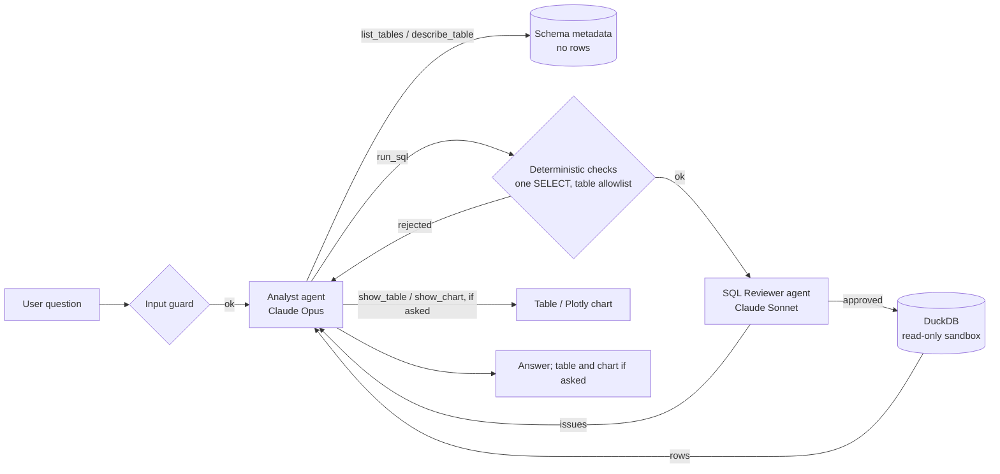

# agentic-data-analyst

Chat with a speedrun database in which human speedrunners and AI agents race retro games. Claude never reads the
data directly. It inspects the schema, **generates SQL**, a second agent reviews that SQL, DuckDB runs it behind
deterministic guards, and the answer comes in text - with a table or chart when you ask for one (the SQL and the flow sit in the collapsible details) in a
[Chainlit](https://chainlit.io) chat.

The stack is deliberately small: the Anthropic SDK with plain tool calls, DuckDB, Chainlit. There is no agent
framework.

## Flow



Chainlit shows each answer as one **Analyst** step with the flow nested inside it (list tables, describe table, SQL
Reviewer, DuckDB, table, chart). The step is collapsed; its output is a trail such as
`Analyst → tables → schema runs → reviewer ✓ → DuckDB 12 rows → line chart → answer`.

| Tool | Purpose |
| --- | --- |
| `list_tables` | Table names, descriptions, approximate row counts |
| `describe_table(table)` | Columns (type, nullable, description) and keys of one table |
| `run_sql(sql)` | Check, review and run one SELECT; up to 200 rows back |
| `show_table()` | The latest result as a table - only when the user asks for a table or list |
| `show_chart(kind, x, y, color, title)` | Bar, line or scatter chart of the latest result - only when the user asks for a chart |

## Safety: deterministic first, LLM judge on top

The reviewer agent catches *wrong* SQL (mixed categories, bad joins). It is not what keeps the system safe. These
layers hold whatever either model does:

| Layer | Mechanism | Where |
| --- | --- | --- |
| Input | Empty and over-long (more than 2,000 characters) messages rejected before any model call | `guardrails.py` |
| Data access | The model sees metadata only, never table rows, except the rows of its own queries | `database.py` |
| Statement | DuckDB's parser: exactly one statement, and it must be a `SELECT` (no DDL, DML, `COPY`, `ATTACH`, `SET`, `INSTALL`) | `check_sql` |
| Allowlist | DuckDB's syntax tree: only the six data tables and CTEs; table functions only `range`/`generate_series`/`unnest` (no `read_csv`, `duckdb_settings()`, file paths) | `check_sql` |
| Sandbox | Read-only file, `enable_external_access=false` (no files, no network), extension autoload/install off, 1 GB memory, 2 threads, `lock_configuration=true` | `connect` |
| Runtime | 20 s deadline via `interrupt()`, at most 200 rows fetched, SQL at most 8,000 characters | `run_query` |
| Loop | At most 8 model rounds per answer; tool errors go back to the model instead of crashing | `agent.py` |
| Cost | Hard budget per answer ($0.50) and per chat ($5.00); an unknown price fails closed | `agent.py`, `app.py` |
| Output | Chainlit renders no HTML (`unsafe_allow_html = false`); charts are built from the rows by code, not by the model | `.chainlit/config.toml`, `charts.py` |
| Secrets | API key only in the environment (`.env`, git-ignored) | `settings.py` |

`tests/bdd/features/queries.feature` proves the allowlist and, separately, that the database blocks file reads,
network access, `getenv`, writes and setting changes even when the allowlist is bypassed.

## Cost controls

- **Prompt caching**: system prompt and tools are cached, and the growing conversation is auto-cached. The reviewer's
  instructions and schema are cached too. (On Haiku 4.5, which caches only prefixes of 4,096 tokens or more, the
  first turns of a chat are not cached.)
- **Right-sized models**: Opus 5.5 at medium effort writes the SQL; Sonnet 5.5 at low effort only judges one query.
  For the lowest cost, set both to `claude-haiku-4-5` ($1 / $5 per million tokens); the request options (effort,
  safety fallbacks) adapt to the model (`settings.request_options`).
- **Cheap checks first**: unsafe or invalid SQL is rejected by the parser before the reviewer is called, so it
  costs no review.
- **Small tools, small results**: the model fetches only the tables it needs; results are capped at 200 rows,
  columnar and rounded.
- **Visible cost**: every answer shows its tokens and cost, plus the chat total.
- **Hard budgets**: see the safety table.

## Data

`make data` writes `data/speedruns.duckdb` from a deterministic seed (`src/agentic_data_analyst/seed.py`). Everything
in it is synthetic: five invented games, 36 human runners and 6 AI agents using tool-assisted search, reinforcement
learning, imitation learning and LLM agents. About 8,400 runs and 44,000 level splits, January 2025 to September 2026.
Tables: `games`, `categories`, `levels`, `runners`, `runs`, `splits`.

Descriptions and keys live in the database itself (`COMMENT ON`, `PRIMARY KEY`, `REFERENCES`) and are read back from
`duckdb_tables()`, `duckdb_columns()` and `duckdb_constraints()`. That gives dbt-style schema documentation without
dbt.

## Quick start

Requires [uv](https://docs.astral.sh/uv/).

```bash
make install
cp .env.example .env   # set ANTHROPIC_API_KEY
make run               # builds the database if missing, then opens Chainlit on http://localhost:8000
```

```bash
make check             # ruff, ruff format, strict mypy, pytest-bdd - no API key or network needed
```

Docker: `docker build -t agentic-data-analyst . && docker run --rm -p 8000:8000 -e ANTHROPIC_API_KEY agentic-data-analyst`

## Layout

| File | Responsibility |
| --- | --- |
| `app.py` | Chainlit UI: flow steps, SQL, tables, charts, cost line, session budget |
| `agent.py` | Analyst prompt, tools, the bounded tool loop, answer budget |
| `reviewer.py` | SQL reviewer agent (structured output) |
| `database.py` | Read-only sandboxed connection, schema inspection, SQL checks, bounded execution |
| `charts.py` | Plotly figures from result rows |
| `seed.py` | Synthetic speedrun database |
| `guardrails.py`, `usage.py`, `settings.py`, `log.py` | Input checks, token cost, configuration, logging |

## Limitations

- No authentication: the per-chat budget resets with a new chat, so a real deployment needs login and a per-user
  budget or rate limit.
- One process, one DuckDB file. Fine for this dataset; a larger one would need a separate query worker.
- Prompt injection through the question can still make the analyst write a *different* SELECT. The deterministic
  layers limit any query to reading these six tables, within the deadline, the row cap and the budget.
- The model-facing behaviour (answer quality, injection resistance) is not covered by the automated tests, which
  script both models.

## License

MIT. See [LICENSE](LICENSE).
